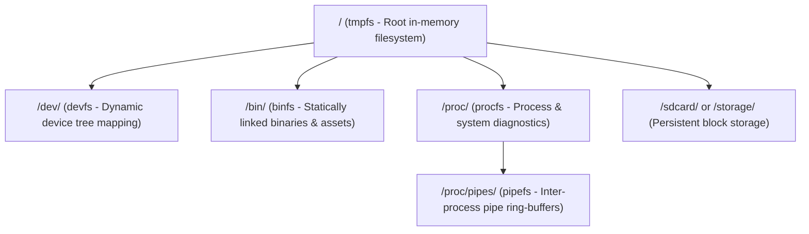

# Virtual Filesystem (VFS) & Subsystems Architecture

The EOS Virtual Filesystem provides a unified, POSIX-compliant interface for interacting with system resources, hardware peripherals, and executable applications, adhering to the principle that **"Everything is a file"**. It integrates multiple specialized filesystem layers mounted atop the root `tmpfs`.

---

## 1. VFS Subsystem Overview & Mount Hierarchy

Unlike vanilla ESP-IDF, which restricts mounting to root sub-paths (`/spiffs`, `/sdcard`), EOS intercepts Newlib reentrant filesystem calls via `eos_vfs_register()` and linker wrappers (`-Wl,--wrap`), enabling true root `/` path management.

---

## 2. tmpfs (Root Filesystem, `ecore/tmpfs.c`)

`tmpfs` serves as the primary root filesystem (`/`), providing hierarchical in-memory file, directory, symlink, and hard link creation, modification, and deletion.

* **Inode & Tree Node Separation:** Inodes (`tmpfs_inode_t`) manage content, data blocks, file size, permissions, and hard link counts (`nlink`). Directory nodes (`tmpfs_fnode_t`) link names in the filesystem hierarchy to inodes.
* **Hard Links:** Supported via `link()`. Multiple tree nodes share a single `tmpfs_inode_t` with incremented `nlink`. Unlinking decrements `nlink` and deallocates data blocks only when `nlink == 0` and reference count reaches zero.
* **Symbolic Links:** Supported via `symlink()`, `readlink()`, and `lstat()`. Symlink targets are stored in `inode->symlink_target` (mode `S_IFLNK | 0777`).
* **Subtree Renames:** Preserves hierarchical child subtrees intact without stripping child node references.
* **POSIX Compliance:** Supports `open`, `read`, `write`, `close`, `lseek`, `unlink`, `link`, `symlink`, `readlink`, `lstat`, `stat`, `fstat`, `mkdir`, `rmdir`, `rename`, `opendir`, `readdir`, `seekdir`, `telldir`, `rewinddir`.

---

## 3. devfs (Device Filesystem, `ecore/devfs.c`)

`devfs` dynamically maps hierarchical device tree nodes and system pseudo-devices to pathnames under `/dev/`:

* **Path Resolution & Device Tree:** Resolves device paths hierarchically by traversing parent-child relationships in the device tree managed by `dev.c`.
* **Standard Character Pseudo-Devices:**
  * `/dev/null`: Discards all written data (returning written byte count) and returns EOF (0 bytes) on read.
  * `/dev/zero`: Discards all written data and fills read buffers with null bytes (`0x00`).
* **POSIX Operations:** Exposes standard file operations (`open`, `close`, `read`, `write`, `lseek`, `ioctl`, `stat`, `fstat`), forwarding peripheral requests directly to the driver abstraction layer (`driver.c`).
* **Directory Enumeration:** `devfs_readdir` enumerates both pseudo-devices (`null`, `zero`) and active device nodes (e.g. `fb0`, `sound0`, `keyboard0`, `wifi0`, `sdio0`, `sdio1`), allowing standard `ls /dev` and `tree /dev` exploration.

---

## 4. binfs (Binary Filesystem, `ecore/binfs.c`)

`binfs` provides an in-memory execution environment for statically linked system commands, native applications, and embedded scripts residing under `/bin/`:

* **Statically Linked Binaries:** Applications are registered at compile-time into the `.eos_bins` linker section using `EOS_BIN_INITIALIZER` macros.
* **Embedded Script Assets:** Shell scripts such as `init.sh` are embedded as text assets and registered in `binfs`, exposed as executable files under `/bin/`.
* **Central VFS Handle Integration:** Binary file state (`binfs_file_t`) and directory streams (`binfs_dir_t`) enlarge base `eos_vfs_file_t` and `eos_vfs_dir_t` handles directly, eliminating internal secondary FD vectors.
* **Directory Stream Rewinds:** Supports `seekdir`, `telldir`, and `rewinddir` for multiple-pass directory traversals.

---

## 5. pipefs (Pipe Filesystem & Ring Buffers, `ecore/pipefs.c`)

`pipefs` exposes anonymous pipes (`pipe(int pipefd[2])`) and named pipe nodes under `/proc/pipes/`:

* **Ring Buffer IPC:** Provides thread-safe in-memory circular buffers for inter-process communication.
* **Shell Pipelines:** Underpins shell command pipelines (`cmd1 | cmd2 | cmd3`), streaming producer stdout into consumer stdin with FreeRTOS semaphore synchronization.
* **Enlarged Base Handles:** Directly embeds pipe endpoint state (`pipe_file_t`, `pipe_dir_t`) in EOS VFS descriptors, eliminating redundant internal file descriptor tracking.

---

## 6. procfs (Process & Diagnostic Filesystem, `ecore/procfs.c`)

`procfs` mounts at `/proc` to expose live process status, thread execution contexts, and device tree diagnostics as virtual files:

| Virtual Node | Description | Queried By |
| :--- | :--- | :--- |
| `/proc/scopes` | Enumerates available driver scopes (`bus`, `display`, `storage`, `net`, `input`, `sound`, `power`). | `devctl scopes` |
| `/proc/drivers` | Lists registered drivers, their scopes, and priorities. | `devctl drivers` |
| `/proc/devices` | Lists active devices attached to the device tree, showing parent-child links. | `devctl devices` |
| `/proc/mounts` | Displays active VFS filesystem mount points. | User scripts, `mount` |
| `/proc/meminfo` | Displays runtime DRAM, PSRAM, and DMA memory capacity and free heap. | `cat`, `lvgl_sysmon` |
| `/proc/uptime` | Displays system uptime in seconds and jiffies. | `uptime` |
| `/proc/cpuinfo` | Displays CPU architecture, core count, frequency, and revision. | System diagnostics |
| `/proc/stat` | Displays CPU time counters (`user_us`, `sys_us`, `wait_us`) and system IRQ accounting. | `time`, `top`, `ps` |
| `/proc/<pid>/` | Per-process virtual directories (`status`, `stat`, `cmdline`, `cwd`, `environ`, `fd/`). | `ps`, process monitors |

Dynamic diagnostic buffers inside `procfs` allocate from external PSRAM via `kvec_psram_t` / `MALLOC_CAP_SPIRAM`, ensuring diagnostic queries never consume scarce internal SRAM.

---

## 7. Unified Upper-Level VFS Architecture & Dynamic PSRAM Descriptors (`ecore/vfs.c`, `ecore/vfs.h`)

EOS routes 100% of filesystem operations through a centralized Virtual File System (VFS) dispatcher and descriptor layer, bypassing ESP-IDF VFS registration for all EOS subsystems:

### 7.1 Architecture & Dynamic PSRAM Descriptor Tables
- **File Descriptors (`eos_vfs_fd_desc_t`):** Managed as a dynamic vector (`s_fd_descs`) allocated in external PSRAM via `kvec_psram_t`. Descriptors are pre-allocated upfront during `eos_vfs_init()` and grow dynamically as required. Each active descriptor contains a dedicated recursive mutex (`lock`), atomic reference count (`ref_count`), open flags (`flags`), and a pointer to the enlarged filesystem-specific `eos_vfs_file_t`.
- **Directory Streams (`eos_vfs_dir_desc_t`):** Managed as a dynamic vector (`s_dir_descs`) in external PSRAM via `kvec_psram_t`. Pre-allocated at boot with dedicated recursive mutexes (`lock`), pointing to enlarged `eos_vfs_dir_t` handles.
- **Enlarged Base Descriptor Model:** Filesystems (`binfs`, `procfs`, `pipefs`, `devfs`, `tmpfs`) embed private state directly into enlarged `eos_vfs_file_t` and `eos_vfs_dir_t` allocations, eliminating secondary per-filesystem FD tables.
- **Resource Configuration Reductions:**
  - `CONFIG_VFS_MAX_COUNT=6`: Reduced across all board configurations, reserving minimal slots solely for low-level ESP-IDF services (Console, USB-Serial-JTAG, lwIP network sockets).
  - `FD_SETSIZE=64`: Configured across all targets to bound `fd_set` memory footprints while safely servicing `CONFIG_LWIP_MAX_SOCKETS=16` plus active user descriptors.

### 7.2 Concurrency Control & Descriptors Lifecycle
- **Serialized I/O Dispatch:** Every VFS wrapper (`read`, `write`, `lseek`, `fstat`, `readdir`, `seekdir`, `telldir`, `rewinddir`) locks the per-descriptor mutex before invoking the underlying filesystem driver callback, guaranteeing race-free multi-threaded I/O and serialized directory traversal.
- **Atomic Reference Tracking:** File descriptor sharing via `dup` and `dup2` updates the underlying descriptor's `ref_count`. Closing a descriptor decrements `ref_count` and invokes the underlying filesystem driver's `close` only when the count reaches zero.
- **Driver Allocation Bypassing:** All filesystem driver internal allocations execute with `eos_proc_heap_tracking_disable()` active. Driver internal structures and dynamic table expansions are never attributed to user process memory blocks.

---

## 8. Symlinks, Hard Links & Cross-Device Rename (Tasks T12 & T17)

* **Symlink Resolution:** Resolved transparently in `eos_vfs_match_mount` and file resolution logic. Recursive symlinks are detected with a strict cutoff limit ($\le 8$ links $\to \text{ELOOP}$) to prevent infinite recursion.
* **Hard Links:** File data sharing with reference counting (`nlink`) supported in `tmpfs`.
* **Cross-Device Handling (`EXDEV`):** `rename()` across disparate mount boundaries returns `EXDEV`. Userland commands (`mv`) catch `EXDEV` and fall back to streaming file copy followed by unlinking the source.
* **Userland Utilities:**
  * `ln [-s] TARGET LINK_NAME`: Creates hard links or symbolic links.
  * `readlink [-f] FILE`: Resolves and prints symbolic link targets.

