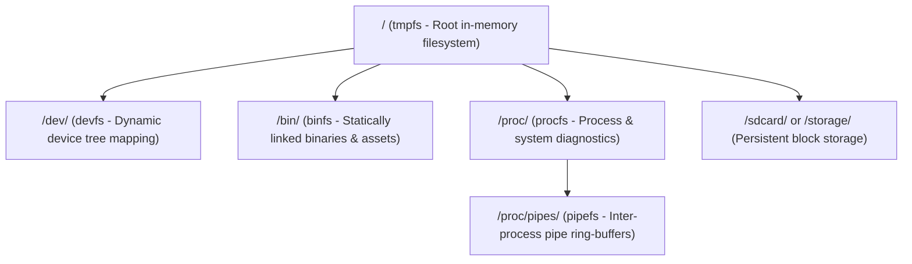

# Virtual Filesystem (VFS) & Subsystems Architecture

The EOS Virtual Filesystem provides a unified, POSIX-compliant interface for interacting with system resources, hardware peripherals, and executable applications, adhering to the principle that **"Everything is a file"**. It integrates multiple specialized filesystem layers mounted atop the root `tmpfs`.

---

## 1. VFS Subsystem Overview & Mount Hierarchy

Unlike vanilla ESP-IDF, which restricts mounting to root sub-paths (`/spiffs`, `/sdcard`), EOS intercepts Newlib reentrant filesystem calls via `eos_vfs_register()` and linker wrappers (`-Wl,--wrap`), enabling true root `/` path management.

---

## 2. tmpfs (Root Filesystem, `ecore/tmpfs.c`)

`tmpfs` serves as the primary root filesystem (`/`), providing hierarchical in-memory file and directory creation, modification, and deletion.

* **Node Structures:** Files and directories are represented as dynamic `tmpfs_fnode_t` nodes.
* **Dynamic Sizing:** File contents expand dynamically in memory chunks.
* **POSIX Compliance:** Supports standard operations: `open`, `read`, `write`, `close`, `unlink` (deleting files via `rm`), `mkdir`, `rmdir`, `rename` (via `mv`), `stat`, `opendir`, and `readdir`.

---

## 3. devfs (Device Filesystem, `ecore/devfs.c`)

`devfs` dynamically maps hierarchical device tree nodes to pathnames under `/dev/`:

* **Path Resolution & Device Tree:** Resolves device paths hierarchically by traversing parent-child relationships in the device tree managed by `dev.c`.
* **POSIX Operations:** Exposes standard file operations (`open`, `close`, `read`, `write`, `lseek`, and `ioctl`), forwarding them directly through the driver abstraction layer (`driver.c`).
* **Directory Enumeration:** `devfs_readdir` iterates through device tree nodes, presenting active device nodes (e.g. `fb0`, `sound0`, `keyboard0`, `wifi0`, `adc0`) as filesystem entries when executing `ls /dev`.

---

## 4. binfs (Binary Filesystem, `ecore/binfs.c`)

`binfs` provides an in-memory execution environment for statically linked system commands, native applications, and embedded scripts residing under `/bin/`:

* **Statically Linked Binaries:** Applications are registered at compile-time into the `.eos_bins` linker section using `EOS_BIN_INITIALIZER` macros.
* **Embedded Script Assets:** Shell scripts such as `init.sh` are embedded as text assets and registered in `binfs`, exposed as executable files under `/bin/`.
* **Execution Flow:** The user shell or execution engine locates binary apps or scripts within `binfs`, resolves metadata (entry point function pointer or text script payload), and spawns or runs them sequentially.

---

## 5. pipefs (Pipe Filesystem & Ring Buffers, `ecore/pipefs.c`)

`pipefs` exposes anonymous pipes (`pipe(int pipefd[2])`) and named pipe nodes under `/proc/pipes/` via ESP-IDF's VFS layer:

* **Ring Buffer IPC:** Provides thread-safe in-memory circular buffers for inter-process communication.
* **Shell Pipelines:** Underpins shell command pipelines (`cmd1 | cmd2 | cmd3`), streaming producer stdout into consumer stdin with FreeRTOS semaphore synchronization.

---

## 6. procfs (Process & Diagnostic Filesystem, `ecore/procfs.c`)

`procfs` mounts at `/proc` to expose live process status, thread execution contexts, and device tree diagnostics as virtual files:

| Virtual Node | Description | Queried By |
| :--- | :--- | :--- |
| `/proc/scopes` | Enumerates available driver scopes (`bus`, `display`, `storage`, `net`, `input`, `sound`, `power`). | `devctl scopes` |
| `/proc/drivers` | Lists registered drivers, their scopes, and priorities. | `devctl drivers` |
| `/proc/devices` | Lists active devices attached to the device tree, showing parent-child links. | `devctl devices` |
| `/proc/mounts` | Displays active VFS filesystem mount points. | User scripts, `mount` |
| `/proc/meminfo` | Displays runtime DRAM, PSRAM, and DMA memory capacity and free heap. | `cat`, `lvgl_sysmon` |
| `/proc/tasks` | Displays active thread contexts, thread IDs, stack sizes, and CWDs. | System monitors |

Dynamic string buffers inside `procfs` allocate from external PSRAM via `kvec_psram_t` / `MALLOC_CAP_SPIRAM`, ensuring diagnostic queries never consume scarce internal SRAM.

---

## 7. Unified Upper-Level VFS Descriptor Synchronization (`ecore/vfs.c`, `ecore/vfs.h`)

EOS enforces centralized synchronization at the Virtual File System (VFS) descriptor level rather than delegating concurrency control to each lower-level filesystem driver:

### 7.1 Architecture & Descriptor Structures
- **File Descriptors (`eos_vfs_fd_desc_t`):** Pre-allocated static table supporting up to `EOS_VFS_MAX_FDS` (128) descriptors. Each active file descriptor contains its own dedicated recursive mutex (`lock`), atomic reference count (`ref_count`), and open flags (`flags`).
- **Directory Streams (`eos_vfs_dir_desc_t`):** Pre-allocated static table supporting up to `EOS_VFS_MAX_DIRS` (32) concurrent open directory streams (`DIR*`), guarded by per-stream recursive mutexes (`lock`).

### 7.2 Boot Invariant & Static Allocation
ESP-IDF POSIX emulation dynamically allocates memory upon the first lock/wait operation of statically initialized primitives (`PTHREAD_MUTEX_INITIALIZER`). If triggered inside a transient child process, the primitive's memory is recorded into the child's allocation registry and prematurely destroyed upon process exit (`waitpid()`).
To prevent this failure mode:
1. `eos_vfs_init()` runs upfront during early kernel startup in `eos_main()` before any filesystem mounts.
2. All 128 file descriptor mutexes and 32 directory mutexes are explicitly initialized with `PTHREAD_MUTEX_RECURSIVE`.
3. Standard streams 0, 1, and 2 (`stdin`, `stdout`, `stderr`) are registered and validated during boot.

### 7.3 Concurrency Control & Descriptors Lifecycle
- **Serialized I/O Dispatch:** Every VFS wrapper (`read`, `write`, `lseek`, `fstat`, `readdir`) locks the per-descriptor mutex before invoking the underlying filesystem driver callback, guaranteeing race-free multi-threaded I/O and serialized directory traversal.
- **Atomic Reference Tracking:** File descriptor sharing via `dup` and `dup2` updates the underlying descriptor's `ref_count`. Closing a descriptor decrements `ref_count` and invokes the underlying filesystem driver's `close` only when the count reaches zero.
- **Driver Allocation Bypassing:** All filesystem driver internal allocations (`pipefs_open`, `procfs_open`, `devfs_open`, `pipe_alloc_node_locked`) execute with `eos_proc_heap_tracking_disable()` active. Driver internal structures and dynamic table expansions are never attributed to user process memory blocks.

### 7.4 BinFS Concurrency & Multi-Thread Execution (`ecore/binfs.c`)
- **Serialized Dynamic Descriptor Allocation:** To support concurrent background tasks (`&`), pipelines (`|`), and subshells executing multiple native binaries simultaneously, `binfs` protects its dynamic descriptor pool (`binfs_fds`) with `s_binfs_mutex`.
- **Race-Free Resizing:** Reallocations of the underlying `kvec_psram_t` table during `binfs_open` are synchronized across cores, preventing descriptor slot corruption or empty-file reads (`load_bin_manifest()`) when multiple commands are spawned in parallel.
- **Thread-Safe Seeking and Reading:** Operations on open binfs descriptors (`binfs_read`, `binfs_lseek`, `binfs_fstat`, `binfs_close`) lock `s_binfs_mutex` throughout data copying and position clamping.

