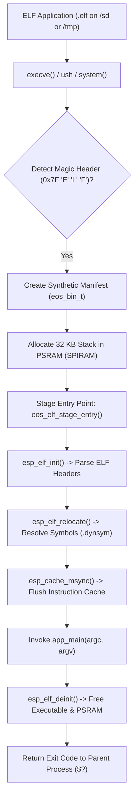

# Dynamic ELF Applications & Runtime Loader

This document details the dynamic ELF loading subsystem, runtime symbol resolution, application compilation, and standalone execution architecture in **EOS (ESP Operating System)**.

---

## 1. Overview & Architecture

Historically, bare-metal and RTOS microcontroller systems require all applications to be compiled into the core monolithic firmware image (`main/ebin/`). EOS breaks this constraint by providing a **Dynamic ELF Loader** powered by Espressif's relocatable ELF loader (`espressif/elf_loader` `^2.0.0`).

With dynamic ELF loading:
* Standalone user applications can be compiled independently outside the main ESP-IDF firmware tree.
* Binaries can be loaded directly from FAT32 SD cards (`/sd/`), flash storage, or RAM filesystems (`/tmp/`).
* Applications execute natively in **External PSRAM**, avoiding internal SRAM exhaustion.
* Shell features (MicroShell `ush`), POSIX reentrant redirection (`<`, `>`, `>>`), pipelines (`|`), background jobs (`&`), and exit status (`$?`) work identically to builtin commands.



---

## 2. Kernel Subsystem (`main/ecore/elf.c`, `elf.h`, `elf_symbols.c`)

The dynamic loader core is encapsulated in `ecore`:

### 2.1 Symbol Registration (`elf_symbols.c`)
At boot time, `eos_elf_init_symbols()` publishes the kernel and library symbols accessible to dynamic binaries via `esp_elf_register_symbol()`. These include:

* **POSIX VFS & File I/O:** `open`, `read`, `write`, `close`, `lseek`, `stat`, `fstat`, `ioctl`, `opendir`, `readdir`, `closedir`, `mkdir`, `rmdir`, `unlink`, `rename`, `chdir`, `getcwd`, `access`.
* **Standard C Streams:** `fopen`, `fread`, `fwrite`, `fclose`, `fseek`, `ftell`, `rewind`, `fflush`, `fgets`, `fputs`, `fprintf`, `fscanf`, `vfprintf`, `remove`.
* **Standard Formatting & Strings:** `printf`, `snprintf`, `sprintf`, `vsnprintf`, `puts`, `putchar`, `getchar`, `strlen`, `strcpy`, `strncpy`, `strcmp`, `strncmp`, `strcat`, `strncat`, `strchr`, `strrchr`, `strstr`, `strtok`, `strdup`, `memcpy`, `memmove`, `memset`, `memcmp`.
* **Process, System & Sleep:** `system`, `eos_system`, `exit`, `abort`, `sleep`, `usleep`, `getpid`, `time`, `gettimeofday`.
* **Dynamic Memory:** `malloc`, `free`, `calloc`, `realloc`, `heap_caps_malloc`, `heap_caps_free`.
* **Graphics & Gaming (SDL 1.2 & SDL 2.0):**
  * SDL 1.2: `SDL_Init`, `SDL_Quit`, `SDL_SetVideoMode`, `SDL_PollEvent`, `SDL_Flip`, `SDL_Delay`, `SDL_GetTicks`, `SDL_ShowCursor`, etc.
  * SDL 2.0: `SDL_InitSubSystem`, `SDL_CreateWindow`, `SDL_CreateRenderer`, `SDL_DestroyRenderer`, `SDL_DestroyWindow`, `SDL_RenderClear`, `SDL_RenderPresent`, `SDL_RenderCopy`, `SDL_CreateTexture`, `SDL_DestroyTexture`, etc.

### 2.2 Path Resolution & Launch Semantics
The loader supports flexible path resolution:
* **Current Directory (`./`):** Executing `./app.elf` or `subdir/app.elf` resolves relative to the current working directory (`cwd`).
* **Absolute Path (`/`):** Executing `/sd/bin/mygame.elf` directly addresses the target file.
* **Environment Search (`$PATH`):** Executing bare `app.elf` searches each colon-delimited directory defined in the `$PATH` environment variable (e.g., `/bin:/sd/bin:/sd`).

### 2.3 Transparent Syscall Routing (`main/ewrap/syscalls.c`)
When MicroShell (`ush`) or `system()` launches a command:
1. `load_bin_manifest()` attempts to open the executable stream.
2. It inspects the first 4 bytes for the ELF magic: `0x7f, 'E', 'L', 'F'` (`0x464C457F`).
3. If detected, it synthesizes an in-memory `eos_bin_t` manifest:
   ```c
   manifest->flags = EOS_BIN_FLAG_STACK_PSRAM;
   manifest->stack_size = 32 * 1024; // 32 KB PSRAM Stack
   manifest->entry_point = eos_elf_stage_entry;
   ```
4. The standard process execution engine spawns the task with dedicated process context (`eos_proc_t`), file descriptor redirection, and process lifecycle tracking.

---

## 3. Developing Applications

### 3.1 Code Generation via Makefile
EOS includes a code generator template for dynamic apps:

```bash
make app
```
You will be prompted for the application name:
```text
Enter value for $APP_NAME$: snake
Generated files (in /home/ai/eos/apps):
  snake/snake.c
  snake/Makefile
```

### 3.2 Anatomy of an Application (`main.c`)
Applications write standard C99/C11 code with `int main(int argc, char **argv)`:

```c
#include <stdio.h>
#include <stdlib.h>
#include <unistd.h>

int main(int argc, char **argv) {
    printf("Running standalone ELF application: %s\n", argv[0]);
    for (int i = 1; i < argc; i++) {
        printf("  Argument [%d]: %s\n", i, argv[i]);
    }
    return 0;
}
```

### 3.3 Application Makefile & Toolchain Discovery
Each app directory contains an autonomous, lightweight Makefile that auto-detects the active target architecture (`esp32s3` Xtensa vs `esp32p4` RISC-V) and locates the Espressif cross-compiler in `$PATH` or `~/.espressif/tools/`:

```makefile
# EOS Standalone ELF Application Makefile
APP_NAME ?= snake
ROOT_DIR ?= $(abspath $(dir $(lastword $(MAKEFILE_LIST)))/../..)
ACTIVE_BOARD ?= $(shell cat $(ROOT_DIR)/.active_board 2>/dev/null || echo "lilka_v23")

ifeq ($(findstring jc4880p4,$(ACTIVE_BOARD)),jc4880p4)
    TARGET ?= esp32p4
    TOOL_PREFIX ?= riscv32-esp-elf-
    ARCH_STRIP_FLAGS = --remove-section=.riscv.attributes
else
    TARGET ?= esp32s3
    TOOL_PREFIX ?= xtensa-esp32s3-elf-
    ARCH_STRIP_FLAGS = --remove-section=.xt.lit --remove-section=.xt.prop --remove-section=.xtensa.info
endif

CC_BIN ?= $(shell which $(TOOL_PREFIX)gcc 2>/dev/null || find $(HOME)/.espressif/tools -name $(TOOL_PREFIX)gcc 2>/dev/null | head -n1)
STRIP_BIN ?= $(shell which $(TOOL_PREFIX)strip 2>/dev/null || find $(HOME)/.espressif/tools -name $(TOOL_PREFIX)strip 2>/dev/null | head -n1)

CC := $(CC_BIN)
STRIP := $(STRIP_BIN)

CFLAGS ?= -O2 -nostartfiles -nostdlib -fPIC -shared -e app_main -Dmain=app_main \
          -fdata-sections -ffunction-sections -Wl,--gc-sections \
          -fvisibility=hidden -Wl,--strip-all -Wl,--strip-debug -Wl,--strip-discarded \
          -I$(ROOT_DIR)/main/include_override

STRIP_FLAGS = --strip-unneeded --remove-section=.comment --remove-section=.got.loc \
              --remove-section=.dynamic $(ARCH_STRIP_FLAGS)

TARGET_ELF = $(APP_NAME).elf
```

### 3.4 Compiling
To build the application:
```bash
make -C apps/snake
```
Output:
```text
Compiling snake.elf for esp32s3 (lilka_v23)...
Build successful: snake.elf (1.2K)
```

The resulting `.elf` file is compact (~1.2 KB) because standard library implementations are resolved dynamically at runtime from the EOS kernel symbol table.

---

## 4. Running ELF Binaries in EOS Shell

Dynamic ELF binaries execute just like native builtin commands in `ush`:

```text
# 1. Execute from current directory:
$ cd /sd
$ ./snake.elf --difficulty=hard

# 2. Execute via absolute path:
$ /sd/games/snake.elf

# 3. Execute via PATH:
$ export PATH=/bin:/sd/bin
$ snake.elf

# 4. Standard I/O Redirection & Pipes:
$ ./my_benchmark.elf > /sd/results.txt
$ ./data_source.elf | grep "Sensor"

# 5. Check exit status:
$ echo $?
0
```

---

## 5. Kconfig Options

Dynamic loading behavior is governed by the following options in `sdkconfig`:

| Configuration Key | Value | Description |
|---|---|---|
| `CONFIG_ELF_LOADER` | `y` | Enables the core ELF loader component (`espressif/elf_loader`). |
| `CONFIG_ELF_LOADER_LOAD_PSRAM` | `y` | Loads ELF program segments into External PSRAM (default). |
| `CONFIG_ELF_LOADER_LIBC_SYMBOLS` | `y` | Exports standard libc symbols into the loader symbol table. |
| `CONFIG_ELF_LOADER_ESPIDF_SYMBOLS` | `y` | Exports core ESP-IDF runtime symbols into the loader table. |
| `CONFIG_ELF_DYNAMIC_LOAD_SHARED_OBJECT` | `n` | Shared object (`.so` / `dlopen`) loading (stubbed for future extension). |
