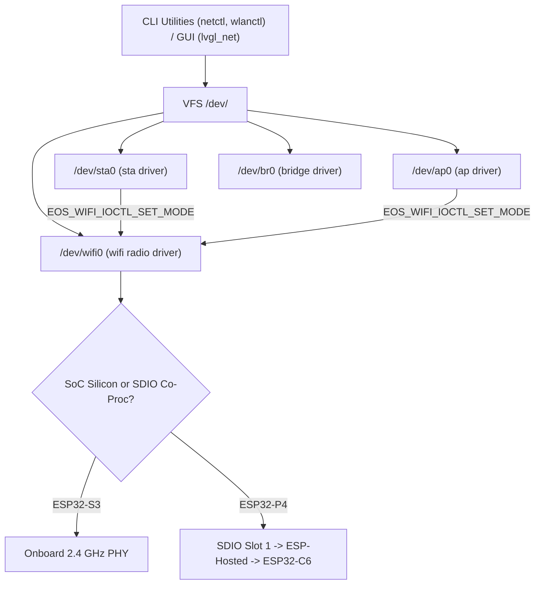

# Network Driver Contracts & TCP/IP Architecture

Network drivers in EOS reside under `scope == "net"`, integrating Espressif's lwIP TCP/IP stack (`esp_netif`), Wi-Fi physical radio control, station (STA) and SoftAP modes, network bridging, and promiscuous 802.11 frame processing.

---

## 1. Supported Network Drivers (`main/edriver/net/`)

| Driver Name | Device Node | Role & Responsibilities | Parent Requirements |
| :--- | :--- | :--- | :--- |
| **`wifi`** | `/dev/wifi0` | Physical Wi-Fi radio lifecycle, NVS flash, lwIP initialization, RF channel, TX power, sniffer, raw frame injection. | `root` (ESP32-S3) or `sdio1` (ESP32-P4 ESP-Hosted) |
| **`sta`** | `/dev/sta0` | Wi-Fi Station interface: connects to external APs, handles DHCP client, link state notifications. | `wifi0` |
| **`ap`** | `/dev/ap0` | Wi-Fi SoftAP interface: broadcasts SSID, manages DHCP server pool, tracks connected clients. | `wifi0` |
| **`bridge`** | `/dev/br0` | Virtual network bridge: forwards Ethernet frames between interfaces, supports NAPT routing. | `root` |

---

## 2. Parent-Child IOCTL Coordination Protocol

To enforce modular encapsulation:
1. **Radio State Encapsulation:** `wifi0` holds the NVS flash initialization, default system event loop, and radio state in its private `dev->state`.
2. **Child Delegation via IOCTL:** When a child driver like `sta0` or `ap0` is brought up, it interacts with the physical radio strictly by issuing IOCTL calls on its parent device (`dev->parent`, e.g. `EOS_WIFI_IOCTL_*`).
3. **Decoupled Architecture:** No global variables or loose C symbols exist across driver boundaries.



---

## 3. Network IOCTL Reference Tables

### Common Netif Operations (`500–517`)
Executed on network interface devices (`/dev/sta0`, `/dev/ap0`, `/dev/br0`):

| IOCTL Command | Code | Argument Type | Description |
| :--- | :---: | :--- | :--- |
| `EOS_NETIF_IOCTL_GET_INFO` | `500` | `eos_netif_info_t *info` | Retrieves IP address, netmask, gateway, link state, and MAC. |
| `EOS_NETIF_IOCTL_SET_UP` | `501` | `none` | Brings network interface administratively UP. |
| `EOS_NETIF_IOCTL_SET_DOWN` | `502` | `none` | Brings network interface administratively DOWN. |
| `EOS_NETIF_IOCTL_SET_IP` | `503` | `const eos_netif_ip_info_t *ip` | Configures static IPv4 address, netmask, and gateway. |
| `EOS_NETIF_IOCTL_GET_IP` | `504` | `eos_netif_ip_info_t *ip` | Queries current IPv4 configuration. |
| `EOS_NETIF_IOCTL_START_DHCPC`| `505` | `none` | Starts DHCP client on interface. |
| `EOS_NETIF_IOCTL_STOP_DHCPC` | `506` | `none` | Stops DHCP client. |
| `EOS_NETIF_IOCTL_START_DHCPS`| `507` | `none` | Starts DHCP server pool (for SoftAP). |
| `EOS_NETIF_IOCTL_STOP_DHCPS` | `508` | `none` | Stops DHCP server pool. |
| `EOS_NETIF_IOCTL_SET_HOSTNAME`| `511` | `const char *hostname` | Configures network hostname. |
| `EOS_NETIF_IOCTL_GET_HOSTNAME`| `512` | `char *hostname` (min 32 B) | Queries network hostname. |
| `EOS_NETIF_IOCTL_SET_MAC` | `513` | `const uint8_t mac[6]` | Reconfigures interface hardware MAC address. |
| `EOS_NETIF_IOCTL_GET_MAC` | `514` | `uint8_t mac[6]` | Queries interface hardware MAC address. |
| `EOS_NETIF_IOCTL_BRIDGE_ADD_IF`| `515` | `const char *ifname` | Attaches a member interface to bridge. |
| `EOS_NETIF_IOCTL_BRIDGE_DEL_IF`| `516` | `const char *ifname` | Removes a member interface from bridge. |
| `EOS_NETIF_IOCTL_BRIDGE_SET_NAPT`| `517` | `bool enable` | Enables or disables IP Network Address Port Translation (NAPT). |

### Station & SoftAP Specific IOCTLs (`518–524`)

| IOCTL Command | Code | Argument Type | Description |
| :--- | :---: | :--- | :--- |
| `EOS_STA_IOCTL_CONNECT` | `518` | `const eos_sta_connect_t *c` | Initiates 802.11 association with SSID and password. |
| `EOS_STA_IOCTL_DISCONNECT` | `519` | `none` | Disconnects from active access point. |
| `EOS_STA_IOCTL_GET_AP_INFO` | `520` | `eos_sta_ap_info_t *info` | Retrieves connected AP BSSID, RSSI, channel, and auth mode. |
| `EOS_STA_IOCTL_SET_AUTOCONNECT`| `521`| `bool enable` | Toggles automatic reconnection on beacon loss. |
| `EOS_AP_IOCTL_SET_CONFIG` | `522` | `const eos_ap_config_t *cfg` | Applies SoftAP SSID, password, channel, and max clients. |
| `EOS_AP_IOCTL_GET_CONFIG` | `523` | `eos_ap_config_t *cfg` | Queries current SoftAP configuration. |
| `EOS_AP_IOCTL_GET_STAS` | `524` | `eos_ap_sta_list_t *list` | Enumerates connected client stations (MAC and RSSI). |

### Physical Radio & Sniffer IOCTLs (`525–537`)
Executed on `/dev/wifi0`:

| IOCTL Command | Code | Argument Type | Description |
| :--- | :---: | :--- | :--- |
| `EOS_RADIO_IOCTL_POWER` | `525` | `int state` (1=on, 0=off) | Powers physical RF synthesizer on or off. |
| `EOS_RADIO_IOCTL_GET_POWER` | `526` | `int *state` | Queries RF power state. |
| `EOS_RADIO_IOCTL_SET_CHANNEL`| `527` | `uint8_t channel` (1–13) | Sets active physical 2.4 GHz RF channel. |
| `EOS_RADIO_IOCTL_GET_CHANNEL`| `528` | `uint8_t *channel` | Queries active RF channel. |
| `EOS_RADIO_IOCTL_SET_TX_POWER`| `529` | `int8_t power_dbm` | Sets transmitter power level in dBm. |
| `EOS_RADIO_IOCTL_GET_TX_POWER`| `530` | `int8_t *power_dbm` | Queries current TX power. |
| `EOS_RADIO_IOCTL_SCAN_START` | `533` | `const eos_wifi_scan_config_t *`| Triggers background active or passive spectrum scan. |
| `EOS_RADIO_IOCTL_SCAN_GET_COUNT`| `534`| `uint16_t *count` | Queries count of discovered BSSIDs. |
| `EOS_RADIO_IOCTL_SCAN_GET_RESULTS`| `535`| `eos_wifi_scan_results_t *` | Copies discovered AP scan table. |
| `EOS_RADIO_IOCTL_SET_PROMISC`| `536` | `const eos_wifi_promisc_cfg_t *`| Enables/disables promiscuous sniffer mode. |

### Parent Coordination IOCTLs (`540–547`)

| IOCTL Command | Code | Argument Type | Description |
| :--- | :---: | :--- | :--- |
| `EOS_WIFI_IOCTL_ENSURE_INIT` | `540` | `none` | Initializes NVS, lwIP, and Wi-Fi subsystem on first use. |
| `EOS_WIFI_IOCTL_SET_MODE` | `541` | `int if_type, bool enable` | Dynamically updates radio mode (`STA`, `AP`, or `APSTA`). |
| `EOS_WIFI_IOCTL_IS_RADIO_ON` | `542` | `bool *out_on` | Checks if RF transceiver is active. |
| `EOS_WIFI_IOCTL_WAIT_CONNECT` | `543` | `uint32_t timeout_ms` | Blocks until station establishes link or timeout expires. |
| `EOS_WIFI_IOCTL_IS_CONNECTED` | `546` | `bool *out_connected` | Checks if station currently holds active IP lease. |

---

## 4. PSRAM Buffer Allocation for Sniffer Mode

In promiscuous capture mode, 802.11 frames arrive at high packet rates. Storing packet queues in internal SRAM consumed 48 KB to 64 KB of critical memory.

In EOS, the raw packet queue (`st->packets`) allocates dynamically from external PSRAM via `heap_caps_calloc_prefer(..., MALLOC_CAP_SPIRAM | MALLOC_CAP_8BIT, MALLOC_CAP_DEFAULT)`. This permanently eliminates internal DRAM bloat while preserving smooth multi-packet buffering.

---

## 5. Declarative Attachment Syntax

```sh
# Onboard Wi-Fi (ESP32-S3 on Lilka v2.3):
devctl attach net wifi root
devctl attach net sta wifi0
devctl attach net ap wifi0

# Co-Processor Wi-Fi via SDIO (ESP32-P4 on Guition JC4880P4):
devctl attach net wifi sdio1 --pin chip_pu=54
devctl attach net sta wifi0
devctl attach net ap wifi0

# Network Bridge:
devctl attach net bridge root
```
