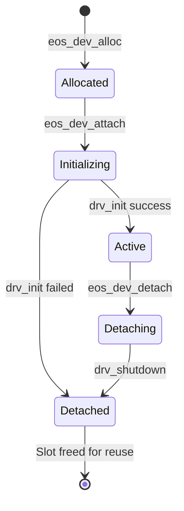

# EOS Unified Driver Contract & Device Model Overview

In **EOS (ESP Operating System)**, all physical and virtual hardware components are governed by the **Unified Device Model**. Under this model, hardware devices are structured into a hierarchical **Device Tree** accessible via standard Virtual Filesystem (VFS) interfaces under `/dev`.

---

## 1. The Driver Structure (`eos_drv_t`, `ecore/driver.h`)

Every driver in EOS implements the `eos_drv_t` contract:

```c
typedef struct eos_drv {
  const char *scope;                  // Driver category: "bus", "display", "storage", "net", "input", "sound", "power"
  const char *name;                   // Unique driver name within scope (e.g. "spi", "st7789", "wifi")
  int32_t priority;                   // Initialization priority (lower = earlier)
  bool is_bus;                        // True if driver can parent child devices
  
  // Lifecycle Handlers
  int (*init)(eos_dev_t *dev);        // Allocates state, configures hardware, claims capabilities
  int (*shutdown)(eos_dev_t *dev);    // Powers down peripheral, frees buffers, releases claimed pins
  int (*attach_req)(eos_dev_t *dev, eos_dev_t *child); // Optional bus attachment validator
  
  // Standard POSIX VFS Operations
  int (*open)(eos_dev_t *dev, const char *path, int flags, int mode);
  int (*close)(eos_dev_t *dev);
  ssize_t (*read)(eos_dev_t *dev, void *buf, size_t count);
  ssize_t (*write)(eos_dev_t *dev, const void *buf, size_t count);
  off_t (*lseek)(eos_dev_t *dev, off_t offset, int whence);
  int (*ioctl)(eos_dev_t *dev, int req, void *arg);
  int (*stat)(eos_dev_t *dev, struct stat *st);
  int (*fstat)(eos_dev_t *dev, struct stat *st);
  
  // Directory Traversal Operations (for bus / container devices)
  DIR *(*opendir)(eos_dev_t *dev, const char *path);
  struct dirent *(*readdir)(eos_dev_t *dev, DIR *dir);
  int (*closedir)(eos_dev_t *dev, DIR *dir);
} eos_drv_t;
```

---

## 2. Compile-Time Registration (`.eos_drivers`)

EOS drivers do not require central registration lists or switch-case initializers. Drivers are declared statically with the `EOS_DRV_ATTR` attribute macro:

```c
EOS_DRV_ATTR eos_drv_t driver_display_st7789 = {
    .scope = "display",
    .name = "st7789",
    .priority = EOS_INIT_PRIO_DISPLAY,
    .is_bus = false,
    .init = st7789_init,
    .shutdown = st7789_shutdown,
    .write = st7789_write,
    .ioctl = st7789_ioctl,
};
```

Linker fragment `main/eld/driver.lf` collects all `eos_drv_t` instances across translation units into the `.eos_drivers` linker section between `_eos_drivers_start` and `_eos_drivers_end`.

---

## 3. Device Lifecycle & Memory Encapsulation



### 1. State Encapsulation (`dev->state`)
Drivers must **never use global or static C variables** to store runtime context. All operational memory, hardware handles, DMA buffers, and FreeRTOS synchronization primitives must reside inside a private context allocated in `dev->state` during `init()`:
```c
st7789_state_t *st = calloc(1, sizeof(st7789_state_t));
if (!st) return -ENOMEM;
dev->state = st;
```

### 2. Capability Claiming (`capsmgr`)
During `init()`, the driver must declare all physical pins and hardware peripherals using the Capability Manager (`capsmgr`):
```c
if (!eos_cap_claim(EOS_CAP_GPIO, pin, dev)) {
  EOS_LOGE(TAG, "GPIO %d already claimed by another peripheral", pin);
  return -EBUSY;
}
```

### 3. Graceful Teardown (`shutdown`)
When a device is detached (`devctl detach <name>` or recursive tree teardown), `shutdown(dev)` is called:
- All hardware timers, DMA channels, and interrupts are stopped.
- Claimed capabilities are freed (`eos_cap_release_all(dev)`).
- Working memory in `dev->state` is freed.

---

## 4. Cross-Driver & Bus Communication via Device Tree (`eos_dev_*`)

To enforce strict architectural decoupling and prevent bypasses of the device hierarchy:
* **Zero Public Device or Bus APIs:** There are no standalone C library functions or header APIs for interacting with buses or devices (such as `scan_i2c_bus` or `sdio_*`).
* **Userspace Interacts Strictly via VFS:** User applications, utilities (`ebin`), and shell scripts communicate with devices exclusively via standard POSIX file operations (`open`, `read`, `write`, `close`, `ioctl`, `opendir`, `closedir`).
* **Kernel & Inter-Driver Interactions via Device Tree:** Communication between drivers (e.g. child device to parent bus, or between cooperating drivers) must **never open files via VFS** (`open("/dev/...")`) and must never invoke direct driver functions. Instead, drivers interact strictly through `eos_dev_*` operations on device tree nodes (`dev->parent`):
```c
// Device tree operations (main/ecore/dev.h):
int eos_dev_open(eos_dev_t *dev, const char *path, int flags, int mode);
int eos_dev_close(eos_dev_t *dev, int fd);
ssize_t eos_dev_read(eos_dev_t *dev, int fd, void *dst, size_t size);
ssize_t eos_dev_write(eos_dev_t *dev, int fd, const void *data, size_t size);
off_t eos_dev_lseek(eos_dev_t *dev, int fd, off_t offset, int whence);
ssize_t eos_dev_pread(eos_dev_t *dev, int fd, void *dst, size_t size, off_t offset);
ssize_t eos_dev_pwrite(eos_dev_t *dev, int fd, const void *src, size_t size, off_t offset);
int eos_dev_ioctl(eos_dev_t *dev, int fd, int cmd, ...);
int eos_dev_ioctl_call(eos_dev_t *dev, int fd, int cmd, ...);
DIR *eos_dev_opendir(eos_dev_t *dev, const char *path);
struct dirent *eos_dev_readdir(eos_dev_t *dev, DIR *pdir);
int eos_dev_closedir(eos_dev_t *dev, DIR *pdir);
```
* **Bus Attachment & Child Protocol:** A child driver communicates with its parent controller using `eos_dev_read`, `eos_dev_write`, and `eos_dev_ioctl` on `dev->parent`. For example, an I2C sensor driver writes transactions to its parent I2C bus via `eos_dev_write(dev->parent, ...)`, and a Wi-Fi station driver configures mode via `eos_dev_ioctl(dev->parent, EOS_DEV_IOCTL_FD_UNUSED, EOS_WIFI_IOCTL_SET_MODE, (void *)WIFI_MODE_STA)`.
* **Device Enumeration via `opendir`/`readdir`:** Device discovery on a bus or `/dev` is performed strictly by opening and reading the directory (`opendir`, `readdir`), triggered after initiating bus probing via an `ioctl` (e.g. `EOS_I2C_IOCTL_PROBE`).

---

## 5. Scope Index & Reserved IOCTL Ranges

| Driver Scope | Base Device Node | Scope Documentation | Reserved IOCTL Range |
| :--- | :--- | :--- | :--- |
| **`bus`** | `/dev/root`, `/dev/spi*`, `/dev/i2c*`, `/dev/sdio*`, `/dev/gpio*`, `/dev/adc*` | [Bus Drivers](./bus.md) | `0–9` (Framework), `100–149` (Per-bus) |
| **`storage`** | `/dev/sd*`, `/dev/flash*` | [Storage Drivers](./storage.md) | `150–199` |
| **`display`** | `/dev/fb*` | [Display Drivers](./display.md) | `200–299` |
| **`input`** | `/dev/keyboard*`, `/dev/input*` | [Input Drivers](./input.md) | `300–399` |
| **`sound`** | `/dev/sound*` | [Sound Drivers](./sound.md) | `400–499` |
| **`net`** | `/dev/wifi*`, `/dev/sta*`, `/dev/ap*`, `/dev/br*` | [Network Drivers](./network.md) | `500–599` |
| **`power`** | `/dev/battery*` | [ADC & Power Drivers](./adc-and-power.md) | `600–699` |
