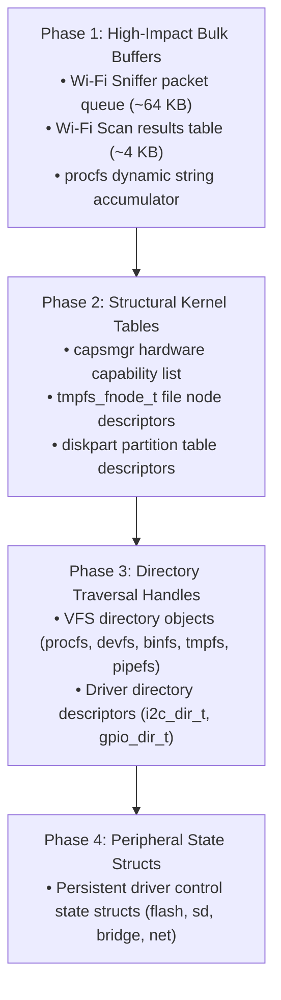

# PSRAM Heap Migration Analysis & Strategic Transfer Plan

This document provides a comprehensive audit of dynamic heap memory allocations across the EOS kernel core (`main/ecore/`) and peripheral/bus drivers (`main/edriver/`). It identifies candidate data structures with infrequent access patterns, evaluates their memory footprint and hardware constraints (such as DMA compatibility), and establishes a phased implementation plan for transferring them to external PSRAM (SPIRAM).

---

## 1. Architectural Motivation

In embedded SoCs (such as the ESP32-S3 and ESP32-P4), on-chip internal SRAM (384 KB – 768 KB) is a scarce, high-demand resource critical for:
1. **FreeRTOS Task Stacks:** Thread stacks require continuous physical internal memory to avoid cache-miss jitter.
2. **Hardware DMA Buffers:** On architectures like the ESP32-S3, hardware DMA controllers for High-Speed SPI and LCD interfaces cannot directly access external PSRAM over SPI/Octal buses without dedicated EDMA channels.
3. **Interrupt Service Routines & Time-Critical Code:** Execution from IRAM requires internal SRAM.
4. **Network Buffers:** Wi-Fi and Bluetooth baseband hardware descriptors and RX/TX ring buffers mandate DMA-capable internal memory.

Conversely, embedded PSRAM offers large capacity (8 MB to 32 MB). While read/write access to external PSRAM incurs a cache-miss latency penalty (approximately 30–50 clock cycles versus 1–2 cycles for internal SRAM), **data structures that are accessed infrequently or are of substantial size should be placed in PSRAM**.

With the implementation of the capability-aware [`kvec`](../main/emisc/kvec.h) (`kvec_psram_t` with explicit `uint32_t caps`) and the global reallocation tracking wrapper (`__wrap_heap_caps_realloc_base` in [`main/ewrap/heap_caps.c`](../main/ewrap/heap_caps.c)), EOS now possesses a verified, leak-free foundation to systematically migrate cold and bulk memory to PSRAM.

---

## 2. Heap Allocation Audit: `main/ecore/` (Kernel Core)

| File & Line | Target Buffer / Struct | Current Allocator | Typical Size | Access Frequency & Pattern | PSRAM Suitability | Recommended Allocation Mechanism |
| :--- | :--- | :--- | :---: | :--- | :---: | :--- |
| **`ecore/procfs.c:70,90`** | `sbuf_t.buf` (Dynamic string buffer) | `malloc()` / `realloc()` | 256 B – 16 KB | **Infrequent:** Only allocated and grown when a process reads `/proc/*` entries (e.g. `meminfo`, `tasks`, `maps`). | **HIGH** | `kvec_psram_t(char)` or `heap_caps_realloc_prefer(..., MALLOC_CAP_SPIRAM \| MALLOC_CAP_8BIT, MALLOC_CAP_DEFAULT)` |
| **`ecore/tmpfs.c:200`** | `tmpfs_fnode_t` (File/dir metadata node) | `malloc(sizeof(tmpfs_fnode_t))` | ~128 B per file/dir | **Medium / Low:** Created on `touch`/`mkdir`/`open(O_CREAT)`. Read during path lookup. | **HIGH** | `heap_caps_malloc_prefer(sizeof(tmpfs_fnode_t), 2, MALLOC_CAP_SPIRAM \| MALLOC_CAP_8BIT, MALLOC_CAP_DEFAULT)` |
| **`ecore/tmpfs.c:834,841`**| `tmpfs_state_t` & root node | `malloc(...)` | ~256 B | **Infrequent:** Allocated once during kernel initialization (`eos_tmpfs_init`). | **HIGH** | `heap_caps_malloc_prefer(..., 2, MALLOC_CAP_SPIRAM \| MALLOC_CAP_8BIT, MALLOC_CAP_DEFAULT)` |
| **`ecore/capsmgr.c:16`** | `ecaps` (Claimed hardware capability list) | `kvec_t(eos_cap_t)` | 12 B per pin/bus (~500 B) | **Infrequent:** Populated during boot and peripheral probe. Static during runtime. | **HIGH** | Migrate to `kvec_psram_t(eos_cap_t) ecaps;` |
| **`ecore/diskpart.c:504`** | `eos_part_table_t` (Partition table data) | `calloc(1, sizeof(...))` | 1 KB – 4 KB | **Rare:** Populated once during storage device initialization and MBR/GPT parsing. | **HIGH** | `heap_caps_calloc_prefer(1, sizeof(eos_part_table_t), 2, MALLOC_CAP_SPIRAM \| MALLOC_CAP_8BIT, MALLOC_CAP_DEFAULT)` |
| **`ecore/exec.c:79,86,97`**| `dup_argv`, `argv`, `exec_arg_t` | `calloc()`, `strdup()` | 100 B – 2 KB | **Infrequent:** Transient storage allocated when launching tasks/binaries via `execve`. | **MEDIUM** | `heap_caps_malloc_prefer(...)` for large command argument blocks. |
| **`ecore/threadctx.c:483,509`**| `twrap`, `env_copy` | `malloc()`, `calloc()` | 200 B – 1 KB | **Infrequent:** Transient parameter bridge used only during `pthread_create()` thread startup. | **MEDIUM** | Safe in PSRAM; transient lifetime. |
| **`ecore/procfs.c:588`**<br>**`ecore/devfs.c:417`**<br>**`ecore/binfs.c:335`**<br>**`ecore/pipefs.c:496`**<br>**`ecore/tmpfs.c:634`** | VFS Directory handles (`*_dir_t`) | `calloc()` / `malloc()` | 32 B – 64 B each | **Infrequent:** Allocated on `opendir()`, freed on `closedir()`. Active only during directory reads. | **MEDIUM** | `heap_caps_calloc_prefer(...)` |
| **`ecore/devfs.c:633`** | `eos_devfs_state` | `calloc(1, sizeof(...))` | ~64 B | **Persistent:** Allocated once at boot. Stores virtual device file descriptor vector. | **LOW** | Keep in internal SRAM for minimal latency during devfs lookups. |
| **`ecore/threadctx.h:26`** | `tctx->memblocks` | `kvec_t(void *)` | Dynamic | **EXTREMELY FREQUENT:** Mutated on **every single `malloc`/`calloc`/`realloc`/`free`**. | **PROHIBITED** | **STRICTLY RETAIN IN INTERNAL SRAM.** Prevents allocation latency degradation and eliminates wrapper recursion hazards. |

---

## 3. Heap Allocation Audit: `main/edriver/` (Drivers)

| Driver & Line | Target Buffer / Struct | Current Allocator | Typical Size | Access Frequency & Pattern | PSRAM Suitability | Recommended Allocation Mechanism |
| :--- | :--- | :--- | :---: | :--- | :---: | :--- |
| **`edriver/net/wifi/wifi.c:963`** | `st->packets` (Raw 802.11 sniffer frame queue) | `calloc(RAW_PACKET_QUEUE_SIZE, sizeof(...))` | **48 KB – 64 KB** | **Diagnostic / Transient:** Only allocated when user enables sniffer (`wlanctl sniffer on` or `dump`). | **CRITICAL (PRIME)** | `heap_caps_calloc_prefer(RAW_PACKET_QUEUE_SIZE, sizeof(eos_wifi_raw_packet_t), 2, MALLOC_CAP_SPIRAM \| MALLOC_CAP_8BIT, MALLOC_CAP_DEFAULT)` |
| **`edriver/net/wifi/wifi.c:896,901`** | `records`, `st->scan_results` (AP scan tables) | `malloc(...)` | 2 KB – 8 KB | **Infrequent:** Allocated exclusively during Wi-Fi access point scans (`wlanctl scan`). | **HIGH** | `heap_caps_malloc_prefer(..., 2, MALLOC_CAP_SPIRAM \| MALLOC_CAP_8BIT, MALLOC_CAP_DEFAULT)` |
| **`edriver/bus/i2c/i2c.c:906`** | `i2c_dir_t` (Directory traversal descriptor) | `calloc(1, sizeof(i2c_dir_t))` | ~48 B | **Infrequent:** Allocated on `opendir("/dev/i2c")`, freed on `closedir()`. | **HIGH** | `heap_caps_calloc_prefer(...)` |
| **`edriver/bus/gpio/gpio.c:365`** | `gpio_dir_t` (Directory traversal descriptor) | `malloc(sizeof(gpio_dir_t))` | ~48 B | **Infrequent:** Allocated on `opendir("/dev/gpio")`, freed on `closedir()`. | **HIGH** | `heap_caps_malloc_prefer(...)` |
| **`edriver/net/sta/sta.c:41`**<br>**`edriver/net/ap/ap.c:31`**<br>**`edriver/net/bridge/bridge.c:33`**<br>**`edriver/net/wifi/wifi.c:507`** | Net device state structs (`sta_state_t`, `ap_state_t`, etc.) | `calloc(1, sizeof(...))` | 128 B – 512 B | **Persistent / Low:** Allocated once when attaching interface (`devctl attach net sta`). | **MEDIUM** | `heap_caps_calloc_prefer(...)` |
| **`edriver/bus/sdio/sdio.c:88`**<br>**`edriver/bus/adc/adc.c:175`**<br>**`edriver/power/battery/battery.c:250`**<br>**`edriver/input/gt911/gt911.c:36`**<br>**`edriver/input/gpio_keyboard/gpio_keyboard.c:82`** | Peripheral driver state structs | `calloc(1, sizeof(...))` / `malloc(...)` | 64 B – 256 B | **Persistent:** Allocated once during driver probe/attachment under bus parents. | **MEDIUM** | `heap_caps_calloc_prefer(...)` |
| **`edriver/storage/sd/sd.c:36`** | `sd_state_t` (SD card controller state) | `malloc(sizeof(sd_state_t))` | ~256 B | **Persistent:** Driver lifecycle state. | **MEDIUM** | `heap_caps_malloc_prefer(...)` |
| **`edriver/storage/sd/sd.c:114`** | `state->io_buff` (SD sector bounce buffer) | `malloc(sector_size)` | 512 B – 4 KB | **Medium:** Used for sector reading/writing when unaligned. | **CONDITIONAL** | **MUST RETAIN DMA CAPABILITY.** On ESP32-S3, requires `MALLOC_CAP_DMA \| MALLOC_CAP_INTERNAL`. On ESP32-P4 with AXI DMA, can use PSRAM. |
| **`edriver/display/st7789/st7789.c:197`** | `ST7789_DMA_STRIP_BYTES` (DMA line strips) | `heap_caps_malloc(..., MALLOC_CAP_DMA)` | 8 KB – 32 KB | **Continuous Streaming:** Touched on every display flush via SPI DMA. | **PROHIBITED** | **STRICTLY RETAIN IN INTERNAL SRAM.** ESP32-S3 SPI DMA cannot source pixel streams from external Octal PSRAM. |

---

## 4. Hardware DMA & Architecture Constraints Matrix

Before moving driver buffers to PSRAM, the target architecture's DMA capabilities must be evaluated:

| SoC Architecture | Bus / Controller | External PSRAM DMA Capable? | Constraint Rule |
| :--- | :--- | :---: | :--- |
| **ESP32-S3** | General SPI (SPI2 / SPI3) | ❌ **No** | Buffers passed to `spi_device_transmit` / `spi_device_queue_trans` **must** be allocated with `MALLOC_CAP_DMA \| MALLOC_CAP_INTERNAL`. |
| **ESP32-S3** | LCD RGB Panel (ST7701S / QEMU) | ✅ **Yes (EDMA)** | RGB panel framebuffers can reside in PSRAM (`MALLOC_CAP_SPIRAM \| MALLOC_CAP_8BIT`). |
| **ESP32-S3** | SDMMC / SD SPI | ❌ **No (SPI mode)** | Bounce buffers (`io_buff`) must reside in internal SRAM with `MALLOC_CAP_DMA`. |
| **ESP32-P4** | High-Speed AXI DMA | ✅ **Yes** | ESP32-P4 includes a high-speed AXI crossbar. Display, SDIO, and network DMA channels can transfer directly to/from PSRAM. |

> [!CAUTION]
> Never migrate buffers destined for hardware DMA on ESP32-S3 SPI peripherals to PSRAM. Always enforce `MALLOC_CAP_DMA | MALLOC_CAP_INTERNAL` for SPI line descriptors.

---

## 5. Phased Transfer Implementation Plan



### Phase 1: High-Impact Transient & Diagnostic Buffers
- **Target 1.1 (`edriver/net/wifi/wifi.c`):**
  Change `st->packets` allocation from plain `calloc` to `heap_caps_calloc_prefer(RAW_PACKET_QUEUE_SIZE, sizeof(eos_wifi_raw_packet_t), 2, MALLOC_CAP_SPIRAM | MALLOC_CAP_8BIT, MALLOC_CAP_DEFAULT)`.
  *Impact:* Instantly frees **~64 KB of internal SRAM** whenever Wi-Fi sniffing is invoked.
- **Target 1.2 (`edriver/net/wifi/wifi.c`):**
  Change `st->scan_results` and `records` to use `heap_caps_malloc_prefer()`.
  *Impact:* Saves **2 KB – 8 KB of SRAM** during AP scanning.
- **Target 1.3 (`ecore/procfs.c`):**
  Convert `sbuf_t` to use `heap_caps_realloc_prefer()`.
  *Impact:* Prevents large `/proc/tasks` and `/proc/meminfo` reports from fragmenting the internal heap.

### Phase 2: Structural Kernel Tables
- **Target 2.1 (`ecore/capsmgr.c`):**
  Convert `ecaps` to `kvec_psram_t(eos_cap_t) ecaps;`.
  *Impact:* Automatically places the system hardware pin matrix table in PSRAM upon `kv_init()`.
- **Target 2.2 (`ecore/tmpfs.c`):**
  Convert `tmpfs_fnode_t` allocations to `heap_caps_malloc_prefer()`.
  *Impact:* Allows creating hundreds or thousands of files/directories in RAM without exhausting internal SRAM.
- **Target 2.3 (`ecore/diskpart.c`):**
  Convert `eos_part_table_t` allocation to `heap_caps_calloc_prefer()`.

### Phase 3: Directory Traversal Handles
- Convert VFS `opendir()` allocations across `procfs`, `devfs`, `binfs`, `pipefs`, and `tmpfs`, as well as driver directories (`i2c_dir_t`, `gpio_dir_t`), to `heap_caps_calloc_prefer()`.
- *Impact:* Guarantees that deep recursive directory listings (such as `tree /` or `tree /proc`) do not starve internal SRAM.

### Phase 4: Long-Lived Driver State Structures
- Migrate `dev->state` allocations across drivers where DMA constraints do not apply (`sta_state_t`, `ap_state_t`, `bridge_state_t`, `flash_state_t`, `sdio_state_t`, `adc_bus_state_t`, `battery_state_t`, `gt911_state_t`).

---

## 6. Implementation Code Pattern

To ensure seamless fallback on boards without PSRAM (or when external RAM is exhausted), all direct allocations must follow the preference pattern:

```c
#include <esp_heap_caps.h>

// Preference pattern: 1st preference PSRAM, fallback to default internal heap
static inline void *eos_psram_alloc_prefer(size_t size) {
#if defined(CONFIG_SPIRAM)
    return heap_caps_malloc_prefer(size, 2, MALLOC_CAP_SPIRAM | MALLOC_CAP_8BIT, MALLOC_CAP_DEFAULT);
#else
    return malloc(size);
#endif
}

static inline void *eos_psram_calloc_prefer(size_t n, size_t size) {
#if defined(CONFIG_SPIRAM)
    return heap_caps_calloc_prefer(n, size, 2, MALLOC_CAP_SPIRAM | MALLOC_CAP_8BIT, MALLOC_CAP_DEFAULT);
#else
    return calloc(n, size);
#endif
}
```

For dynamic arrays, simply declare the field using:
```c
kvec_psram_t(MyType) my_vector;
```
Standard `kv_init(my_vector)` and `kv_push(MyType, my_vector, val)` will automatically route through `heap_caps_realloc_prefer()` and be tracked in thread context via `__wrap_heap_caps_realloc_base`.

---

## 7. Migration Implementation & Verification Status

All candidates across `main/ecore/` and `main/edriver/` (excluding `tctx->memblocks` and hardware DMA buffers) have been fully transferred to PSRAM prefer via [`main/emisc/psram_alloc.h`](../main/emisc/psram_alloc.h):

| Component / Subsystem | Files Migrated | Allocated Structures | Allocator / Vector |
| :--- | :--- | :--- | :--- |
| **Wi-Fi Subsystem** | `main/edriver/net/wifi/wifi.c`<br>`main/edriver/net/sta/sta.c`<br>`main/edriver/net/ap/ap.c`<br>`main/edriver/net/bridge/bridge.c` | • Sniffer raw packet queue (`st->packets`, ~64 KB)<br>• Scan tables (`records`, `st->scan_results`)<br>• Driver states (`wifi_radio_state_t`, `sta_state_t`, `ap_state_t`, `bridge_state_t`) | `eos_psram_calloc_prefer`<br>`eos_psram_malloc_prefer` |
| **Kernel Filesystems (VFS)** | `main/ecore/procfs.c`<br>`main/ecore/devfs.c`<br>`main/ecore/tmpfs.c`<br>`main/ecore/binfs.c`<br>`main/ecore/pipefs.c`<br>`main/ecore/diskpart.c` | • `sbuf_t` dynamic string accumulator<br>• Directory traversal handles (`procfs_dir_t`, `devfs_dir_t`, `tmpfs_dir_t`, `binfs_dir_t`, `pipe_dir_t`)<br>• Tmpfs file nodes (`tmpfs_fnode_t`, root node, state)<br>• Devfs file descriptor map (`devfs_fdmap_t`)<br>• Partition table (`eos_part_table_t`) | `eos_psram_malloc_prefer`<br>`eos_psram_calloc_prefer`<br>`eos_psram_realloc_prefer`<br>`kvec_psram_t(devfs_fdmap_t)` |
| **Hardware Capabilities & Exec** | `main/ecore/capsmgr.c`<br>`main/ecore/exec.c`<br>`main/ecore/threadctx.c`<br>`main/ecore/lvgl.c` | • Pin capabilities list (`ecaps`)<br>• Process argument arrays & strings (`dup_argv`, `argv`, `ex`)<br>• Thread startup bridge (`twrap`, `env_copy`)<br>• Input dialog data (`eos_input_dialog_data_t`) | `kvec_psram_t(eos_cap_t)`<br>`eos_psram_malloc_prefer`<br>`eos_psram_calloc_prefer`<br>`eos_psram_strdup` |
| **Bus Drivers** | `main/edriver/bus/gpio/gpio.c`<br>`main/edriver/bus/i2c/i2c.c`<br>`main/edriver/bus/spi/spi.c`<br>`main/edriver/bus/sdio/sdio.c`<br>`main/edriver/bus/adc/adc.c` | • Bus state structs (`gpio_bus_state_t`, `i2c_bus_state_t`, `spi_state_t`, `sdio_state_t`, `adc_bus_state_t`)<br>• Directory handles (`gpio_dir_t`, `i2c_dir_t`) | `eos_psram_malloc_prefer`<br>`eos_psram_calloc_prefer` |
| **Peripherals & Drivers** | `main/edriver/power/battery/battery.c`<br>`main/edriver/input/gt911/gt911.c`<br>`main/edriver/input/gpio_keyboard/gpio_keyboard.c`<br>`main/edriver/display/st7789/st7789.c`<br>`main/edriver/display/st7701s/st7701s.c`<br>`main/edriver/display/qemu_rgb/qemu_rgb.c`<br>`main/edriver/sound/max98357/max98357.c`<br>`main/edriver/storage/partition/partition.c`<br>`main/edriver/storage/sd/sd.c` | • Peripheral driver control states (`battery_state_t`, `gt911_state_t`, `gpio_keyboard_state_t`, `st7789_state_t`, `st7701s_state_t`, `qemu_rgb_state_t`, `max98357_state_t`, `partition_state_t`, `sd_state_t`)<br>*(Note: Hardware DMA buffers and raw SPI flash controller states like `flash_state_t` are strictly retained in internal SRAM to prevent Cache Error panics during cache-disabled flash operations)* | `eos_psram_malloc_prefer`<br>`eos_psram_calloc_prefer` |

### Validation Results

- **Physical Lilka v2.3 Hardware (ESP32-S3):** **186 / 186 passed (100%)** across `procfs`, `pratt`, `devctl` (including full 12-device peripheral detach & reattach lifecycle), `wlanctl`, `netctl`, `gui`, `emisc`, and `coreutils`.
- **Guition JC Board (ESP32-P4):** **188 / 188 passed (100%)** across `procfs`, `pratt`, `devctl`, `wlanctl`, `netctl`, `sdio`, `gui`, `emisc`, and `coreutils`.
- **QEMU Simulator (`esp32s3_qemu`):** **113 / 113 passed (100%)** across all compatible virtual hardware test suites.
- **Architectural Layer Audit:** **11 / 11 passed (0 violations)**.

