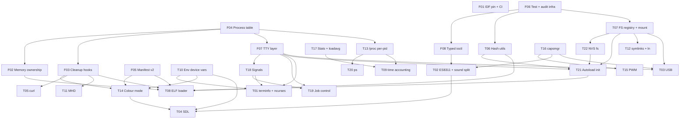

# EOS implementation order

Companion to `eos-tasks.md`. Task IDs match that file. Sizes are rough single-developer guesses (**S** 1–2 days · **M** 3–7 days · **L** 2–3 weeks · **XL** 4+ weeks).

## Ordering principles

1. **Foundations before features.** About half of the original items need a process table, a terminal layer or a cleanup registry. Building those once costs less than building each feature around its own workaround.
2. **Decide shared structures once.** The manifest format (F05) is touched by T14 and T08; the ioctl convention (F08) is touched by T02, T14, T15, T16 and T03. Decide before the first user.
3. **Cheap, independent wins early.** They raise confidence and unblock others (T10, T06, T17, T07).
4. **Highest-risk and largest items last** (T08 ELF loader, T04 SDL, T03b USB device), when the platform under them is stable.
5. **Safety work stays ahead of anything that adds threads or loads code.** F02 and F03 come before T05, T11 and T08.

---

## Dependency graph

---

## Phases

### Phase 0 — Foundations
**Tasks:** F01 → F06 → F04 → (F02, F03 in either order) → F05 → F08
**Effort:** about 3–4 weeks in total.

| Step | Why here |
|---|---|
| F01 IDF pin and CI | Cheapest insurance; every later wrapper depends on it |
| F06 test / audit infra | Every following task adds a test and often an audit rule |
| F04 process table | Root dependency of F02, F03, F07, T13, T18, T19, T20, T09 |
| F02 memory ownership | Fixes the cross-thread free and attach-lifetime hazards before more threads and apps are added |
| F03 cleanup hooks | Needed by T05, T11, T14, T08 |
| F05 manifest v2 | One breaking change, done before T14 and T08 touch the struct |
| F08 typed ioctl | Convention in place before T02/T15/T16/T14 add ioctls |

**Exit criteria:** CI green on S3, P4 and QEMU; `test_leaks` passes; every binary builds against manifest v2; display scope migrated to the typed ioctl macro.

### Phase 1 — Quick wins and observability base
**Tasks:** T10, T06, T17, T07, T13, T20
**Effort:** about 2–3 weeks.

Order inside the phase:
1. **T10** (S): unblocks T01, T14, T04.
2. **T06** (S): unblocks T21, T08.
3. **T17** (S): sdkconfig change plus `/proc/loadavg`; unblocks T09.
4. **T07** (M): unblocks T22, T21, T12, T03.
5. **T13** (M) then **T20** (S): the first visible payoff of F04.

**Exit criteria:** `cat /proc/filesystems`, `umount` by path or device, `ps`, `sha256sum`, `uptime` all work on all targets.

### Phase 2 — Terminal and process control
**Tasks:** F07 → T18 → T19 → T01, and T09 in parallel
**Effort:** about 6–8 weeks.

- **F07** first (largest piece; echo, termios, line discipline).
- **T18** next; Ctrl-C wiring comes from F07.
- **T19** after T18.
- **T01** last in this chain: needs `SIGWINCH`, raw mode, `TERM`.
- **T09** can run whenever T13 and T17 are done; it only touches the dispatch wrappers.

**Exit criteria:** ncurses `top` runs full-screen over UART; Ctrl-C and Ctrl-Z work against the right job; `time` reports user/sys.

### Phase 3 — Persistence and trust
**Tasks:** T22 → T21, and T12a–c in parallel
**Effort:** about 3–4 weeks.

- **T22** needs T07's pseudo-filesystem mounts and moves NVS init out of `wifi0`.
- **T21** needs T22 (trust store), T06 (hash), F07 (prompt), T07 (hook).
- **T12a–c** (symlinks, `ln`, `EXDEV`) are independent of T21. Then write the T12d findings (own VFS or not).

**Exit criteria:** insert a card with `.eos/init.sh` → prompt → trusted; `ln -s` works; `mv` across filesystems works; NVS files survive reboot.

### Phase 4 — Hardware drivers
**Tasks:** T16 → T15 → T14, then T02, then T03a → T03b
**Effort:** about 8–12 weeks (hardware-dependent).

- **T16** first: PWM, DMA and interrupt claims are used by T15, T02 and T03.
- **T15** gives the backlight consumer; **T14** needs F05, F03 and T10 only, so it can start right after T16 (or even earlier).
- **T02** (sound split, ES8311): needs the I2S bus abstraction and typed control ioctls.
- **T03a** host mode before **T03b** device mode. Host reuses TTY, storage and input scopes; device mode has the endpoint-budget and PHY-sharing complications.

**Exit criteria:** backlight dimming on both boards; colour mode switching; play and record via ES8311; USB stick and keyboard in host mode.

### Phase 5 — Libraries and applications
**Tasks:** T05, T11 (either order), then T04
**Effort:** about 4 weeks for T05+T11, 6+ weeks for T04.

- **T05 and T11** depend only on F03 (and a working network driver). They are good candidates to interleave with Phase 4 when waiting on hardware.
- **T04** is last here because it needs audio capture/format control (T02), device selection (T10) and pixel formats (T14). Start its **coverage spike** earlier, since it is a one-day script that sizes the work.

**Exit criteria:** `curl https://…` and a hello-world MHD server work and clean up after themselves; reference SDL programs run on QEMU and hardware.

### Phase 6 — Loadable apps
**Tasks:** T08
**Effort:** 4+ weeks, plus the ABI table design started in Phase 0.

Deliberately last: it changes the app model, needs F02 (ownership), F03 (cleanup), F05 (manifest), T06/T21 (trust), and interacts with executable-memory limits that should be measured first (a one-day spike can be done at any time).

**Exit criteria:** a program built outside the firmware loads from SD, runs, exits, leaks nothing; the ABI index test passes after new exports are added.

---

## Critical paths

| Path | Length |
|---|---|
| F04 → F07 → T18 → T19 → T01 | longest chain; gates the "real terminal" milestone |
| F06 → T07 → T22 → T21 → T08 | gates trust and loadable apps |
| T16 → T02 → T04 | gates audio and SDL |
| F04 → F03 → T05/T11/T08 | gates network libraries and the loader |

## Milestones

| | Milestone | After |
|---|---|---|
| M1 | **Observable system** (`ps`, `/proc`, loadavg, filesystems, hashes) | Phase 1 |
| M2 | **Real terminal** (job control, signals, ncurses `top`) | Phase 2 |
| M3 | **Persistent and trusted** (NVS, symlinks, trusted autorun) | Phase 3 |
| M4 | **Hardware complete** (PWM, colour modes, codec, USB) | Phase 4 |
| M5 | **Ecosystem** (curl, MHD, SDL apps) | Phase 5 |
| M6 | **Loadable apps** | Phase 6 |

## Parallel work and fallbacks

- **Only QEMU available:** do F01–F08, T06, T07, T10, T13, T17, T18, T19, T20, T09, F07 (UART backend), T12a–c, T22 (flash partition in QEMU), T05/T11 only if QEMU networking exists. Leave T02, T03, T14 (real panels), T15 for when a board is attached.
- **While a hardware task is blocked on a board:** switch to T05/T11 or the T04 coverage spike.
- **Short, cheap spikes worth doing at any time** (1 day each): SDL coverage script (T04), executable-memory test on S3 and P4 (T08), IDF VFS limits probe (T12d), endpoint budget on S3 OTG (T03).

## If time is short

| Budget | Do | Defer |
|---|---|---|
| ~1 month | Phase 0 + Phase 1 | everything else |
| ~3 months | Phases 0–2 + T22/T21 | USB device mode, SDL, loader |
| ~6 months | Phases 0–4 | T04 full port, T08 |

## Candidates to cut or shrink

| Item | Suggestion |
|---|---|
| T12d own VFS | Do not start without evidence from the VFS-limits probe; T07 + T12a–c cover most needs |
| T03b "ppp-modem" | Replace by CDC-NCM; keep PPP as optional |
| T04 | Keep to the reference programs; do not aim at "complete SDL" |
| T05 `curl_multi` | Leave until a real consumer exists |
| T08 signing | Start with hash allow-list only |
