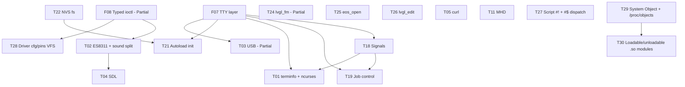

# EOS implementation order

Companion to [`tasks.md`](tasks.md). Completed phases and tasks (Phase 0 `F01–F06`, Phase 1, `T09`, `T12`, `T23`, `T14–T16`, `T08`) are archived in [`history.md`](history.md). Sizes are rough single-developer guesses (**S** 1–2 days · **M** 3–7 days · **L** 2–3 weeks · **XL** 4+ weeks).

## Ordering principles

1. **Foundations before features.** Process table, cleanup registry, manifest ABI, and filesystem registry are in place; remaining foundation work (`F07` TTY, `F08` typed ioctl) gates terminal and driver features.
2. **Decide shared structures once.** Typed ioctls (`F08`) gate `T02`, `T03`, and `T28`; unified object handles and ABI headers (`T29`) gate loadable `.so` modules (`T30`).
3. **Cheap, independent wins early.** `T27` (script `#!` + `#$` dispatch), `T25` (`eos_open`), and `T24` (`lvgl_fm` completion) can land ahead of larger driver/loader work.
4. **Highest-risk and largest items last.** `T04` (SDL) and `T30` (loadable/unloadable `.so` modules with strict PSRAM allocation and refcounting) land after their underlying contracts (`T02`, `T29`) are stable.

---

## Remaining Dependency Graph

---

## Active Phases

*(Phase 0 `F01–F06`, Phase 1 `T06/T07/T10/T13/T17/T20`, and Phase 6a `T08` are complete — see [`history.md`](history.md).)*

### Phase 0 (Remainder) — Typed IOCTL Audit
**Tasks:** `F08` (Partial)
**Exit criteria:** All ioctl macros have typed argument structs and documentation; `layer_audit.py` ioctl rule active.

### Phase 2 — Terminal and process control
**Tasks:** `F07` → `T18` → `T19` → `T01` *(`T09` already Done)*
**Effort:** about 5–7 weeks.

- **F07** first (echo, termios, line discipline).
- **T18** next; Ctrl-C wiring comes from F07.
- **T19** after T18.
- **T01** last in this chain: needs `SIGWINCH`, raw mode, `TERM`.

**Exit criteria:** ncurses `top` runs full-screen over UART; Ctrl-C and Ctrl-Z work against the right job.

### Phase 3 — Persistence, trust, and userland tools
**Tasks:** `T22` → `T21`; `T24` (Partial), `T25`, `T26` in parallel *(`T12`, `T23` already Done)*
**Effort:** about 3–4 weeks.

- **T22** moves NVS init into an `efs` filesystem driver.
- **T21** needs `T22` (trust store) and `F07` (prompt).
- **T24 / T25 / T26** (`lvgl_fm`, `eos_open`, `lvgl_edit`) can be completed in parallel.

**Exit criteria:** `.eos/init.sh` trust prompt works; NVS files survive reboot; `lvgl_fm` opens files via `eos_open` and edits them in `lvgl_edit`.

### Phase 4 (Remainder) — Hardware drivers
**Tasks:** `T02`, `T03` (Partial: remaining host/device polish) *(`T16`, `T15`, `T14` already Done)*
**Effort:** about 3–5 weeks (hardware-dependent).

- **T02** (sound split, ES8311): needs I2S bus abstraction and typed control ioctls (`F08`).
- **T03** remaining USB host/device stabilization and endpoint/PHY edge cases.

**Exit criteria:** play and record via ES8311; USB host/composite device suites green across boards.

### Phase 5 — Libraries and applications
**Tasks:** `T05`, `T11` (either order), then `T04`
**Effort:** about 4 weeks for `T05+T11`, 6+ weeks for `T04`.

- **T05 and T11** are good candidates to interleave when waiting on hardware.
- **T04** stays last here because it needs audio capture/format control (`T02`).

**Exit criteria:** `curl https://…` and a hello-world MHD server work and clean up after themselves; reference SDL programs run on QEMU and hardware.

### Phase 6b — Dynamic System Objects, Driver Config VFS & Loadable Modules
**Tasks:** `T27` (S), then `T28` (M) and `T29` (M) in parallel, then `T30` (L)
**Effort:** about 4–6 weeks.

1. **T27 (S):** Direct `#!` shebang dispatch in `exec.c`/`ush` + bounded `#$ Key=Value` script manifests (`EOS_BIN_FLAG_SCRIPT`, zero `eos_bin_t` ABI break).
2. **T28 (M):** `eos_drv_param_t` reusing `eos_cfg_type_t`, centralized read-only `/dev/<name>/{cfg,pins}/*` VFS + `devctl attach` validation (Step 2a), and opt-in `EOS_PARAM_LIVE` writes (Step 2b). Can run in parallel with `T29`.
3. **T29 (M):** Tagged `eos_handle_t`, 12-byte `(magic, struct_size, abi_version)` header on `eos_drv_t` and `eos_fs_type_t`, `/proc/objects`, and `layer_audit.py` enforcement of no-legacy-ABI-shims + contiguous `1_to_2`..`(N-1)_to_N` step-upgrader chains.
4. **T30 (L):** Strict PSRAM-only `.elf`/`.so` allocation (`MALLOC_CAP_SPIRAM`, `-ENOMEM` on failure with zero SRAM fallback), standalone `.so` build target, `eos_mod_objects[]` export, refcounted `rmmod` (`-EBUSY`), and IRAM ISR trampoline rule.

**Exit criteria:** scripts with `#!` + `#$` run from CLI and launcher; `/dev/<drv>/{cfg,pins}/*` validates bounds and stale FDs; `/proc/objects` enumerates all objects; `.so` modules load strictly in PSRAM, upgrade via ABI step-upgraders if needed, refuse unload while busy, and pass 10× leak cycles.

---

## Critical paths

| Path | Length |
|---|---|
| `F07 → T18 → T19 → T01` | longest terminal chain; gates the "real terminal" milestone |
| `T22 → T21` (with `F07`) | gates trusted autorun |
| `F08 → T02 → T04` | gates audio and SDL |
| `T29 → T30` | gates dynamic loadable/unloadable `.so` drivers and filesystems |

## Milestones

| | Milestone | Status / Gate |
|---|---|---|
| M1 | **Observable system** (`ps`, `/proc`, loadavg, filesystems, hashes) | Done ([`history.md`](history.md)) |
| M6a | **Loadable ELF apps** (`T08`) | Done ([`history.md`](history.md)) |
| M2 | **Real terminal** (job control, signals, ncurses `top`) | Phase 2 |
| M3 | **Persistent and trusted** (NVS, trusted autorun, `lvgl_fm`/`eos_open`/`lvgl_edit`) | Phase 3 |
| M4 | **Hardware complete** (ES8311 codec, USB completion) | Phase 4 |
| M5 | **Ecosystem** (curl, MHD, SDL apps) | Phase 5 |
| M6b | **Dynamic system objects & `.so` modules** (`T27–T30`) | Phase 6b |

## Parallel work and fallbacks

- **Only QEMU available:** do `F08`, `F07` (UART backend), `T18`, `T19`, `T01`, `T22` (flash partition in QEMU), `T25`, `T26`, `T27`, `T28`, `T29`, `T30` (`/tmp` `.so` fixtures). Leave `T02` and physical USB `T03` checks for when a board is attached.
- **Quick wins anytime:** `T27` (S), `T25` (S), and `T24` remaining items.

## If time is short

| Budget | Do | Defer |
|---|---|---|
| ~1 month | `F08` + `T27` + `T25` + `T24`/`T26` | Phase 2 TTY, SDL, `.so` modules |
| ~3 months | Phases 2–3 + `T28` + `T29` | `T04` SDL, `T30` `.so` modules |
| ~6 months | Phases 2–4 + Phase 6b (`T27–T30`) | `T04` full port |

## Candidates to cut or shrink

| Item | Suggestion |
|---|---|
| `T03b` "ppp-modem" | Replace by CDC-NCM; keep PPP as optional |
| `T04` | Keep to the reference programs; do not aim at "complete SDL" |
| `T05` `curl_multi` | Leave until a real consumer exists |
| `T28` live writes | Start with Step 2a (read-only VFS + attach validation); add `EOS_PARAM_LIVE` opt-in incrementally |
